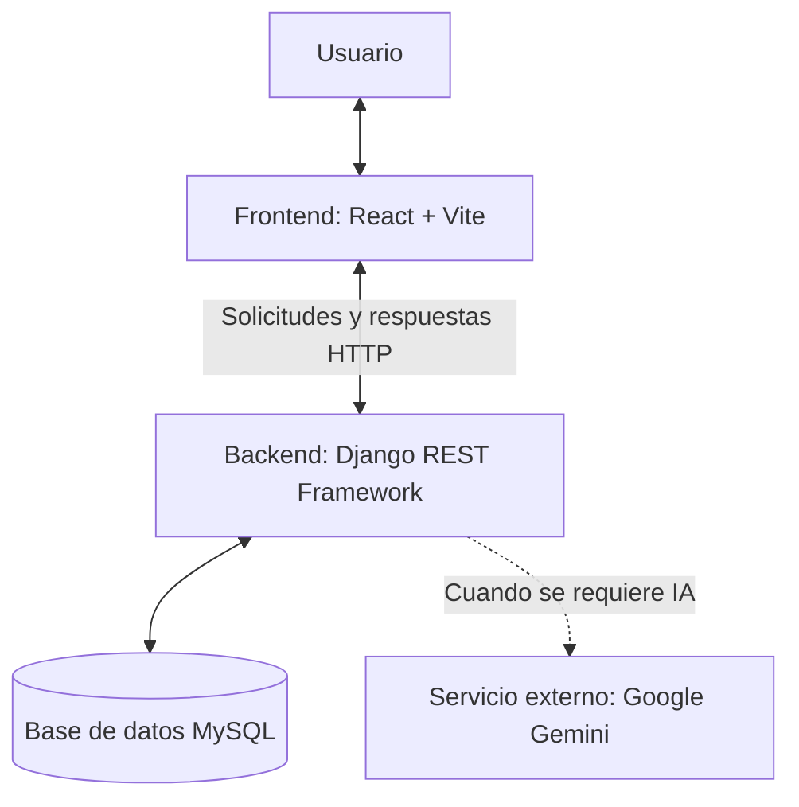

# Body Rhythm

Body Rhythm es una plataforma web de fitness diseñada para apoyar la gestión del entrenamiento. Permite consultar ejercicios, organizar rutinas, registrar actividades y acceder a funcionalidades de seguimiento del progreso y asistencia mediante inteligencia artificial.

## Tecnologías utilizadas

- **Frontend:** React y Vite, responsables de la interfaz de usuario.
- **Backend:** Django y Django REST Framework, encargados de la lógica de negocio y la API.
- **Base de datos:** MySQL, utilizada para almacenar y consultar la información de la aplicación.
- **Comunicación:** solicitudes y respuestas HTTP entre el frontend y el backend.
- **Inteligencia artificial:** integración con Google Gemini mediante la configuración de `GEMINI_API_KEY` en el backend.

## Arquitectura del sistema

La aplicación utiliza una arquitectura cliente-servidor. El usuario interactúa con la interfaz desarrollada en React, que envía solicitudes HTTP a la API del backend. Django REST Framework procesa las solicitudes y se comunica con MySQL cuando necesita consultar o guardar información.

Para las funcionalidades que lo requieren, el backend también puede comunicarse con el servicio externo de inteligencia artificial Google Gemini. Finalmente, la API devuelve las respuestas al frontend para presentarlas al usuario.

## Flujo de las solicitudes

1. El usuario interactúa con la aplicación desde el frontend.
2. React envía solicitudes HTTP a los endpoints de la API.
3. Django REST Framework recibe y procesa las solicitudes.
4. Cuando corresponde, el backend consulta o actualiza la información almacenada en MySQL.
5. En las funcionalidades que lo requieren, el backend puede solicitar asistencia al servicio de Google Gemini.
6. La API devuelve una respuesta que el frontend presenta al usuario.

## Alcance de la documentación

Este documento presenta una descripción general de la arquitectura y las tecnologías de Body Rhythm. El diagrama representa los componentes principales y sus relaciones de comunicación; no detalla todos los módulos internos ni todos los endpoints de la aplicación.
