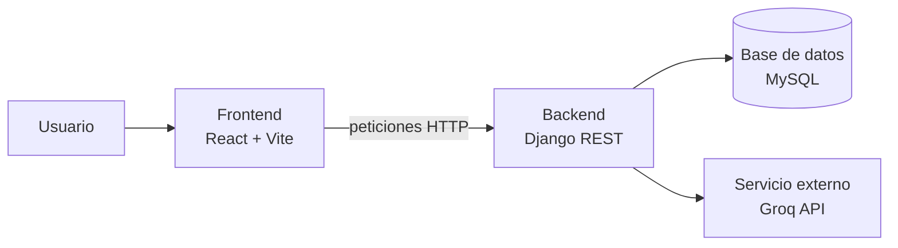

# Body Rhythm

Aplicación web full-stack de fitness que ayuda a los usuarios a entrenar y seguir su progreso.
Incluye rutinas personalizadas según objetivo e IMC, y un chatbot con IA para generar rutinas.

## Qué problema resuelve y para quién

<Una o dos líneas: por ejemplo, personas que quieren empezar a entrenar y no saben qué rutina seguir ni cómo medir su avance.>

## Tecnologías

- **Frontend:** React + Vite
- **Backend:** Django 4.2 + Django REST Framework
- **Base de datos:** MySQL (XAMPP en local)
- **IA:** Groq API (chatbot de rutinas)
- **Control de versiones:** Git y GitHub

## Integrantes

| Integrante | GitHub | Rol |
|---|---|---|
| juan david | [@juandavid-zz](https://github.com/juandavid-zz) | Perfil, entrenamientos y dashboard |
| Kevin | <@usuario> | Ejercicios y progreso |
| José Fernando | <@usuario> | Rutinas y admin |

## Arquitectura



## Cómo instalar y ejecutar

### Requisitos
- Node.js 18+
- Python 3.10+
- XAMPP (MySQL activo)

### Backend
```bash
cd backend
python -m venv venv
venv\Scripts\activate          # Windows
pip install -r requirements.txt
cp .env.example .env           # completa tus propias credenciales
python manage.py migrate
python manage.py runserver
```

### Frontend
```bash
cd frontend
npm install
npm run dev
```

## Decisiones técnicas

- **Django REST Framework:** <por qué: el equipo ya conocía Django, trae serializers y permisos listos>.
- **Django 4.2 y no la última versión:** es compatible con la versión de MariaDB/MySQL de XAMPP.
- **MySQL:** <por que es la que mas conocemos, ya que hemos trabajado con ella antes>.
- **React + Vite:** <por qué: arranque rápido y recarga instantánea en desarrollo>.
- **Groq para el chatbot:** <por qué es la mejor opccion gratuita >.

## Pruebas

<Qué probaron y cómo: por ejemplo, pruebas manuales de cada módulo, endpoints probados con Postman, etc.>

## Estructura de carpetas

```
body-rhythm/
├── backend/     # API Django REST
├── frontend/    # Aplicación React + Vite
└── README.md
```