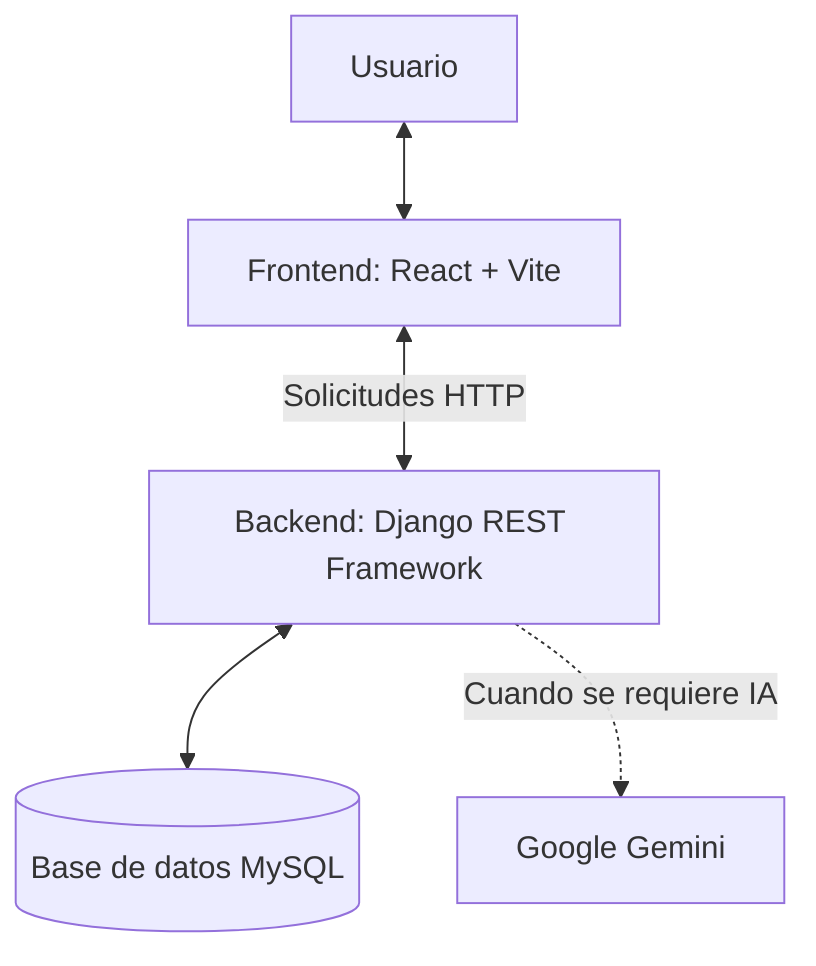

# Body Rhythm

Body Rhythm es una plataforma web de fitness diseñada para apoyar la gestión del entrenamiento. Permite consultar ejercicios, organizar rutinas, registrar actividades y hacer seguimiento del progreso, con funcionalidades de inteligencia artificial.

La plataforma está dirigida a personas que desean organizar sus entrenamientos de acuerdo con sus objetivos y consultar información que les ayude a mejorar sus hábitos de ejercicio.

## Qué problema resuelve y para quién

Body Rhythm busca facilitar la organización y el seguimiento de las actividades físicas, especialmente para personas que necesitan una guía para estructurar sus rutinas y registrar su progreso. También incorpora funcionalidades de inteligencia artificial para apoyar la generación de rutinas personalizadas.

## Tecnologías utilizadas

- **Frontend:** React y Vite, utilizados para desarrollar la interfaz de usuario.
- **Backend:** Django 4.2 y Django REST Framework, encargados de la lógica de negocio y la API.
- **Base de datos:** MySQL, utilizado para almacenar y consultar la información de la aplicación.
- **Comunicación:** solicitudes HTTP entre el frontend y el backend.
- **Inteligencia artificial:** integración con Google Gemini mediante la variable de configuración `GEMINI_API_KEY`.
- **Control de versiones:** Git y GitHub.

## Integrantes

| Integrante | GitHub | Responsabilidades |
|---|---|---|
| Juan David | [@juandavid-zz](https://github.com/juandavid-zz) | Perfil, entrenamientos y dashboard |
| Kevin | [@teriax](https://github.com/teriax) | Ejercicios y progreso |
| José Fernando | [@gargola11](https://github.com/gargola11) | Rutinas y administración |
> Completa los perfiles de GitHub de Kevin y José Fernando con sus usuarios reales antes de entregar el documento.

## Arquitectura del sistema

Body Rhythm utiliza una arquitectura cliente-servidor. El usuario interactúa con la interfaz desarrollada en React, que envía solicitudes HTTP al backend. Django REST Framework procesa las solicitudes y se comunica con MySQL para consultar o almacenar información.

Cuando una funcionalidad requiere inteligencia artificial, el backend puede comunicarse con Google Gemini. Finalmente, la API devuelve la respuesta al frontend para presentarla al usuario.



## Flujo de las solicitudes

1. El usuario interactúa con la aplicación desde el frontend.
2. React envía una solicitud HTTP a la API.
3. Django REST Framework recibe y procesa la solicitud.
4. El backend consulta o actualiza la información almacenada en MySQL, cuando corresponde.
5. El backend puede comunicarse con Google Gemini cuando la funcionalidad lo requiere.
6. La API devuelve una respuesta que el frontend presenta al usuario.

## Cómo instalar y ejecutar

### Requisitos

- Node.js 18 o superior.
- Python 3.10 o superior.
- XAMPP con MySQL activo.
- Git.

### Backend

Desde la carpeta principal del proyecto, abre una terminal y ejecuta:

```bash
cd backend
python -m venv venv
```

En Windows, activa el entorno virtual:

```bash
venv\Scripts\activate
```

Instala las dependencias:

```bash
pip install -r requirements.txt
```

Configura las variables de entorno a partir del archivo `.env.example`, si está disponible, y completa las credenciales correspondientes. Luego ejecuta:

```bash
python manage.py migrate
python manage.py runserver
```

El servidor de desarrollo de Django estará disponible normalmente en `http://127.0.0.1:8000/`.

### Frontend

Abre otra terminal y ejecuta:

```bash
cd frontend
npm install
npm run dev
```

Vite mostrará en la terminal la dirección local donde puedes abrir la aplicación.

## Decisiones técnicas

- **Django REST Framework:** se utiliza para construir una API que separa la lógica del backend de la interfaz del frontend y facilita el manejo de serializadores y permisos.
- **Django 4.2:** se eligió como versión del framework backend del proyecto.
- **MySQL:** se utiliza como sistema de gestión de base de datos para almacenar la información de la aplicación.
- **React + Vite:** permite construir una interfaz basada en componentes y facilita el desarrollo mediante recarga en caliente.
- **Google Gemini:** se integra para ofrecer funcionalidades de inteligencia artificial, como el apoyo a la generación de rutinas personalizadas.

## Pruebas

La validación del sistema debe contemplar:

- La ejecución del backend y la comprobación de su configuración.
- La conexión del backend con la base de datos MySQL.
- La navegación por las pantallas principales del frontend.
- El funcionamiento de los módulos de ejercicios, rutinas y seguimiento del progreso.
- Las funcionalidades de inteligencia artificial, cuando estén configuradas.

Para comprobar la configuración de Django, se puede ejecutar desde la carpeta `backend`:

```bash
python manage.py check
```

Documenta también las pruebas que el equipo haya realizado realmente, por ejemplo, pruebas manuales o pruebas de endpoints con Postman.

## Estructura de carpetas

```text
body-rhythm/
├── backend/       # API y lógica de negocio con Django
├── frontend/      # Interfaz web con React y Vite
└── README.md      # Documentación del proyecto
```

## Alcance de la documentación

Este documento presenta una descripción general de la arquitectura, las tecnologías y los pasos de instalación de Body Rhythm. El diagrama representa los componentes principales y sus relaciones de comunicación; no detalla todos los módulos internos ni todos los endpoints de la API.
